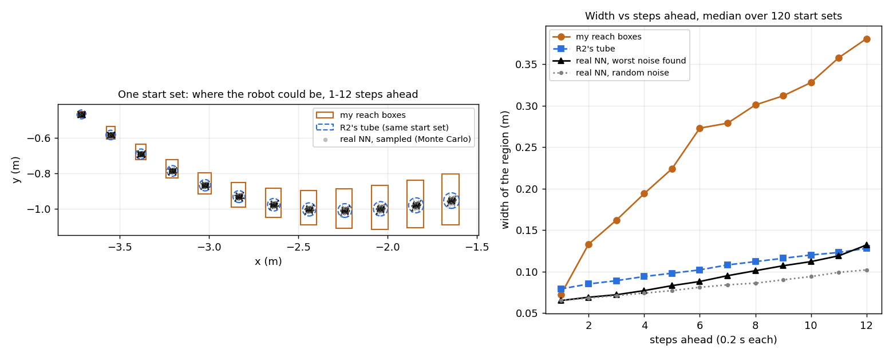

# Reach-PSF: a safety filter for neural-network controllers

This branch (`reach-psf`) is my safety-filter project, built on the lab's CARV
code. The lab's original README is in
[docs/README_lab_original.md](docs/README_lab_original.md).

**Short version:** I built a safety filter that uses reachability analysis. I
compared it against a standard filter based on tube MPC. Both were equally safe,
and both stepped in about equally often. Mine didn't beat it, and I found the
reason why. The project is shelved.


*One run of my filter:*
- *Top: the robot (black) drives toward the star. The orange boxes are where
  the NN could take it in the next 20 steps. The teal curves are backup routes
  ready to take over.*
- *Middle: green means a safe backup exists that far ahead, red means none
  does.*
- *Bottom: red marks when the backup is actually driving.*

---

## The problem

- A robot drives at a constant speed of 1 m/s and can only choose how fast it
  turns. Each time step is 0.2 s.
- A neural network (NN) picks the turn rate. The NN is good at reaching the
  goal, but it has no safety guarantee.
- The robot only knows its position roughly. Each measurement is off by up to
  ±0.15.
- A **safety filter** sits between the NN and the robot. It lets the NN's
  command through when it can prove that's safe. Otherwise it switches to a
  backup plan.

The goal is a filter that **never crashes** and **steps in as rarely as
possible**.

## My method: Reach-PSF

Code: [alg28_sound.py](nfl_robustness_training/src/alg28_sound.py)

1. Every step, it computes boxes that are guaranteed to contain everywhere the
   NN could take the robot, given the measurement noise. These are the
   "reach boxes".
2. If the boxes stay clear of obstacles, the NN keeps driving.
3. It always keeps a backup plan ready, built one step ahead with MPC (a
   planner that solves an optimization problem). If the boxes hit an
   obstacle, the backup takes over.

Why I thought it would win: all the checking happens one step ahead, so the
robot never waits on a solver. And looking at the NN's own future might let it
step in less often.

### How I changed CARV's reachability to handle noise

**What CARV does (the lab's code).** It uses CROWN (the `auto_LiRPA` library)
to bound where the robot can go under the NN, x(t+1) = f(x, NN(x)). The NN sees
the **true** state. The only uncertainty is the starting box. CARV can bound
several steps in one CROWN call ("symbolic"), or chain one-step boxes
("concrete").

**The problem.** In my setting the NN sees a noisy estimate, x + e, and the
error e changes every step. CARV's model has no place for that.

**What I changed** (`_joint_bounder` and `joint_step` in
[alg28_sound.py](nfl_robustness_training/src/alg28_sound.py)):

1. **Error as an extra input.** One step becomes f(x, NN(x + e)). CROWN bounds
   it over both the state box and the error box at once (6 inputs instead of
   3). A fresh error box is used every step.
2. **Size of the error box.** It's at most the measurement noise (±0.15), and
   tighter when the estimator's own box is smaller ("rule S").
3. **Splitting.** The 6-D input box is cut into 256 cells, mostly along heading
   and heading error. Each cell is bounded separately and the results are
   merged. That takes about 13 ms per step.
4. **A guaranteed starting box.** The lab's Kalman-filter box is replaced by a
   set-membership estimator: the predicted box intersected with the
   measurement box. It always contains the true state.

**Why not CARV's multi-step ("symbolic") mode?** Each extra step adds 3 new
error inputs. In my tests it was looser than chaining one-step boxes beyond
about 5 steps, and too slow for the 0.2 s step.

## What I compared against

Code: [alg29_generic_psf.py](nfl_robustness_training/src/alg29_generic_psf.py)

- **R2, the real competitor.** A standard filter built on tube MPC. It plans a
  backup route and puts a "tube" around it that covers the measurement error.
  A solve takes time, and the robot keeps moving meanwhile. So R2 first
  predicts where the robot will be when the solve finishes, plans from there,
  and applies the result one step later. This is called delay compensation.
- **G1**: the same kind of filter, but it ignores its solve time. It shows what
  goes wrong without delay compensation.
- **R1**: the tube filter assuming solving takes zero time. Not realistic,
  just a reference.

All filters get the same scenes, the same noise and the same NN.


*One scene, three filters. Left: zero solve time (ideal). Middle: ignores a
0.1 s solve time, ends up off its plan, and crashes. Right: delay-compensated,
and it flies the same path as the ideal.*

---

## Results

**Intervention rate** = the percentage of time steps where the filter changed
the NN's command. Lower is better.

### 500 random scenes (noise ±0.15)

| Filter | Crashes | Intervention rate | Compute per step |
|---|---|---|---|
| Mine | 0 | 4.81% | 94 ms |
| R2 | 0 | 4.97% | 75 ms |

- The gap is 0.16 percentage points. That's within noise: the 95% interval is
  −0.10 to +0.43.
- Even if my filter's own delay is removed entirely, which is unrealistic, the
  gap is only 0.26 points, and still not significant.
- G1, which ignores its solve time, crashed in about a quarter to a third of
  scenes at some delays. So delay compensation matters a lot. R2 already has
  it.

### Corridor test

The MPC only plans 12 steps (2.4 m) ahead. So I built a corridor longer than
that, to see whether my filter could see far enough to let the NN go straight
through.


Neither filter went through. Both went around. No crashes in any setting
(100 runs each):

| Noise | Corridor free width | Mine | R2 |
|---|---|---|---|
| ±0.15 | 1.0 m | 25.4% | 23.3% |
| ±0.15 | 1.8 m | 25.6% | 26.7% |
| ±0.05 | 1.0 m | 23.9% | 23.2% |
| ±0.05 | 1.8 m | 28.1% | 25.8% |
| ±0.017 | 1.0 m | 22.7% | 22.8% |
| ±0.017 | 1.8 m | 27.3% | 25.8% |

**These numbers are noisy for my filter.** I re-ran the exact same code on the
exact same scenes at low noise, and my filter's rate moved by 7 to 18
percentage points (for example 23% in one run, 40% in another). The reason: how
far ahead it checks depends on how much computing fits into each 0.2 s step,
and that changes from run to run. R2 doesn't have this problem. So treat
"mine" as anywhere from about R2's level to clearly worse, never better.

**Why mine didn't go in:** its reach boxes grow quickly, from 7 cm to 43 cm wide
in 3 to 4 steps. By the time they reach the entrance, they're wider than the
corridor.

The scene files are in
[runs/alg45_corridor/](nfl_robustness_training/cluster_scripts/runs/alg45_corridor/)
(`corridor_k15_*.json`).

---

## Checking that R2 is correct

A broken competitor could make the comparison meaningless, so I checked R2 three
ways.

- **By hand.** I worked out one step of the robot's motion on paper and
  compared it with the code. They match.
  [handcheck_r2_prediction.py](nfl_robustness_training/cluster_scripts/checks/handcheck_r2_prediction.py)
  also tests 1,000,000 random states, and none land outside R2's predicted
  region.
- **In the simulation.** Over 30,000 steps, the real robot was always inside
  R2's tube, and R2's backup plan was always still valid.
- **Against the literature.** "Predict where you'll be when the solve finishes,
  then plan from there" is the standard way to handle solver delay in MPC.

These checks did catch a real bug once. R2 was moving its position estimate
forward but not its uncertainty, so it planned from stale information and
crashed in 269 of 500 scenes. That's fixed, and every number above is after the
fix.

## Why my filter can't win

12 steps ahead, my boxes are about 3 times wider than R2's tube. Is that just a
weakness of how I compute them? To find out, I measured the NN's **real**
spread by simulating thousands of possible starts and noise patterns (Monte
Carlo), and I searched for the worst noise pattern.



*Left: one typical start set. Orange boxes are my reach boxes. Blue circles
are R2's tube, built from the same start set. Black dots are where the real NN
actually took the robot over thousands of simulated runs. Right: the same
widths, as a median over 120 start sets.*

Width of the region the robot could be in (noise ±0.15):

| Steps ahead | My boxes | R2's tube | Real NN, worst case found |
|---|---|---|---|
| 4 | 0.19 m | 0.09 m | 0.08 m |
| 8 | 0.30 m | 0.11 m | 0.10 m |
| 12 | 0.38 m | 0.13 m | 0.13 m |

What this shows:

1. **My boxes are too loose.** The boxes forget that the NN steers each state
   back toward the path, so they treat its corrections like extra noise.
2. **But even perfect boxes wouldn't win.** 12 steps ahead, the NN's real worst
   case is already as wide as R2's tube. That's exactly the range where my
   filter would need to see further than R2.
3. **The root cause:** the NN reads a noisy measurement every step, so every
   step's noise gets into its path. R2's backup follows a fixed list of
   commands and ignores measurements, so the noise can't pile up.

So better tools (zonotopes, finer splitting, symbolic bounds) can't fix this.
Any filter that tries to certify the NN's own future runs into it.

Scripts:
[box_vs_tube.py](nfl_robustness_training/cluster_scripts/checks/box_vs_tube.py),
[true_spread.py](nfl_robustness_training/cluster_scripts/checks/true_spread.py),
[worst_spread.py](nfl_robustness_training/cluster_scripts/checks/worst_spread.py).

---

## Where things are

```
README.md                      this file
docs/
  CLUSTER_HANDOFF.md           how to set up and run on MIT Engaging
  README_lab_original.md       the lab's original README
  img/                         figures used here
nfl_robustness_training/
  src/                         code that runs (table below)
  results/
    alg29/                     full lab notebook for the comparison + figures
    alg28/                     animations, figures, proof sketch
    alg22/ alg20/ di/          older versions
  cluster_scripts/
    scripts/                   Slurm job scripts and summary tools
    runs/                      per-experiment settings and written predictions
    checks/                    the checks and figures in this README
  archive/                     old code, see archive/README.md
third_party/                   nfl_veripy, CROWN and other libraries
gifs/                          the lab's demo gifs
```

Main files in `src/`:

| File | What it does |
|---|---|
| `alg28_sound.py` | my filter (Reach-PSF) |
| `alg29_generic_psf.py` | the baselines: R1, R2, G0–G3 |
| `REAL_integrated_sim.py` | the simulator, NN loading, reachability |
| `mpc_safety_filter_acados.py` | the MPC backup planner |
| `state_estimator.py` | tracks the region the robot could be in |
| `run_trials_random_obs.py` | runs many random scenes, saves results |
| `alg22_di.py`, `run_trials_di.py` | the same for a simpler robot model (double integrator) |
| `anim_alg28.py` | makes the animations |

The other files in `src/` are the lab's original code, or older versions that
these still import.

## How to run

- Setup: [docs/CLUSTER_HANDOFF.md](docs/CLUSTER_HANDOFF.md). Use the `carv`
  conda env and submit jobs with `sbatch`. Simulations don't run on the login
  node.
- Each experiment's settings are in the `arms.txt` files under
  `cluster_scripts/runs/`.
- The noise level is `TTTCARV_VMAX_SIGMA`, times 0.05. The default of 3 gives
  ±0.15.
- Raw run data is in `~/runs/` on Engaging, not in git.

## If you pick this up

- Better reachability tools won't help (see "Why my filter can't win").
- What might help is a different NN, one trained to react less to measurement
  noise. Or certify the NN only a few steps ahead and leave the rest to the
  backup, but that's basically what R2 already does.
