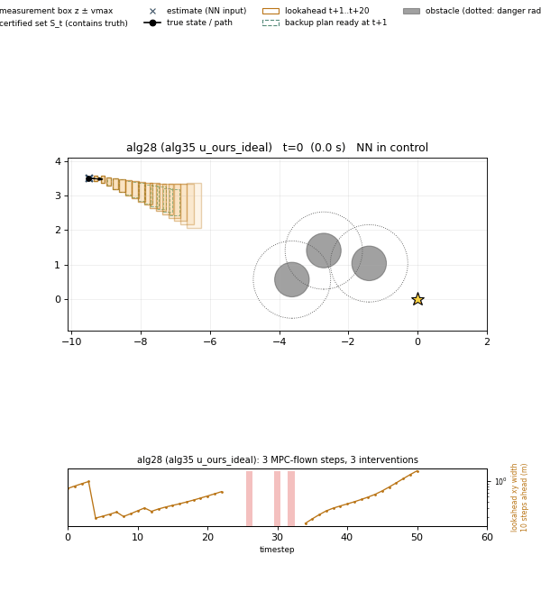
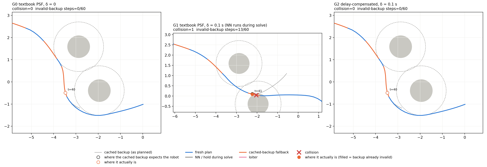
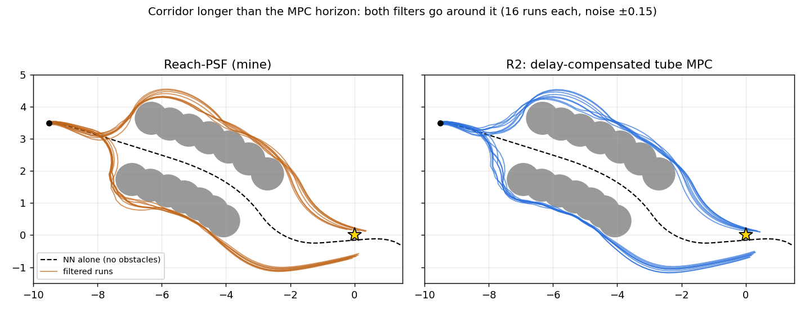
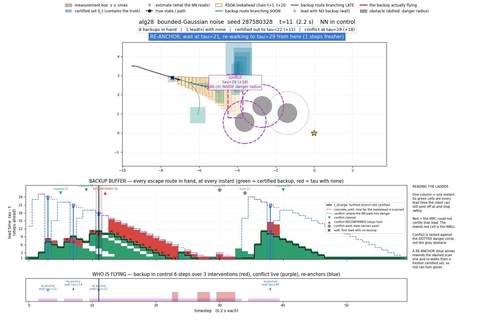

# Reach-PSF: a reachability safety filter for NN controllers

This branch (`reach-psf`) holds my safety-filter project, built on top of the
lab's CARV code. It covers what I built, what I compared it against, and why I
stopped. The lab's original README is in
[docs/README_lab_original.md](docs/README_lab_original.md). Last updated
2026-11-02.



*One run of the filter (bounded-Gaussian noise).*

- **Top panel.** Black is the robot's true path. The orange boxes are where the
  NN could take the robot over the next 20 steps. The teal curves are the
  backup routes the filter has ready. The purple circle marks where the NN's
  path would first come too close to an obstacle.
- **Middle panel.** For every time step, this shows how far ahead a certified
  backup exists (green) and where none does (red).
- **Bottom panel.** This shows when the backup is actually driving (red).

## The idea

A neural-network controller drives a unicycle robot (constant speed 1 m/s,
turn rate limited to ±1 rad/s, 0.2 s time steps) through a field of circular
obstacles. The robot only gets noisy measurements of its position and heading.

A safety filter sits between the NN and the robot. Most of the time it lets the
NN command through. When it can't prove the NN is safe, it takes over with a
backup plan.

My filter, Reach-PSF ([alg28_sound.py](nfl_robustness_training/src/alg28_sound.py)),
checks the NN with reachability analysis. It computes boxes that are guaranteed
to contain every state the robot could reach under the NN, given the
measurement noise. If those boxes stay clear of obstacles and end somewhere the
robot can safely circle forever, the NN keeps driving. Otherwise an MPC backup
plan takes over.

The pitch was that a reachability filter can do its checking one step ahead,
so it never makes the robot wait on a solver, and that it would step in less
often than a standard MPC-based filter.

## What I compared against

The baselines are in
[alg29_generic_psf.py](nfl_robustness_training/src/alg29_generic_psf.py). The
important ones:

- **R2, delay-compensated tube MPC filter.** This is the fair competitor. It
  knows its solve takes time, so it takes the current set of possible states,
  pushes it forward through the command already being applied, solves from
  that predicted set, and applies the result at the next step.
- **R1**: the same tube MPC, but it pretends solving takes zero time. You
  couldn't actually deploy this. It's a reference point.
- **G1**: a textbook MPC filter that ignores its own solve time. This is the
  "what goes wrong if you don't compensate" baseline.

All filters see the same scenes, the same noise and the same NN.



*One scene, three textbook filters. The middle one ignores its 0.1 s solve
time. Its backup plan assumes the robot is still where it was when the solve
started, so the robot ends up off-plan and crashes. The delay-compensated
version (right) flies the same path as the zero-delay ideal (left).*

## Results

"Intervention" means the percentage of time steps where the filter changed the
NN's command. Lower is better. Brackets are 95% paired confidence intervals.

**Main comparison** (500 random scenes, uniform noise ±0.15):

| Filter | Collisions | Intervention | Compute per step |
|---|---|---|---|
| Reach-PSF (mine, real-time version) | 0 | 4.81% | 94 ms |
| R2, delay-compensated tube MPC | 0 | 4.97% | 75 ms |

R2 minus mine is +0.16 pp [−0.10, +0.43], which isn't significant. Even if I
let my filter skip the delay entirely (an unrealistic best case, 4.71%), the
gap only grows to +0.26 pp [−0.01, +0.54]. That's still not significant.

For comparison, G1 (ignores its solve time) collided in roughly a quarter to a
third of scenes at some delays (0.15 s and 0.3 s). So delay compensation
matters a lot, but R2 already does it, and once it does, my filter has no edge.

### Corridor test

I built a corridor longer than the MPC's 2.4 m planning horizon. The idea was
that the reachability check might let the NN fly straight through, where the
MPC can't plan far enough ahead to prove it's safe.



Neither filter ever went into the corridor. Both went around it. 100 trials per
setting, 0 collisions for everyone:

| Noise | Corridor gap | Mine | R2 |
|---|---|---|---|
| ±0.15 | 1.0 m | 25.4% | 23.3% |
| ±0.15 | 1.4 m | 25.6% | 26.7% |
| ±0.05 | 1.0 m | 23.9% | 23.2% |
| ±0.05 | 1.4 m | 28.1% | 25.8% |
| ±0.017 | 1.0 m | 22.7% | 22.8% |
| ±0.017 | 1.4 m | 27.3% | 25.8% |

Mine didn't go in because its boxes grow fast (one went from 7 cm to 43 cm wide
in 3 or 4 steps, even at ±0.05 noise). By the entrance they're wider than the
gap.

The first corridor scene I tried looked like a big win: R2 collided in 88/100
trials. That turned out to be unfair. R2 had no valid 12-step plan from the
starting position, so it fell back to circling and hit the first wall. I moved
the corridor further away so both filters started from a feasible position.
Both scenes are in
[cluster_scripts/runs/alg45_corridor/](nfl_robustness_training/cluster_scripts/runs/alg45_corridor/)
(`corridor_d1.0.json` is the unfair one, `corridor_k15_*` the fair ones).

## Checking the delay compensation

I wanted to be sure R2 wasn't secretly broken in a way that made it look good.

- **By hand**
  ([handcheck_r2_prediction.py](nfl_robustness_training/cluster_scripts/checks/handcheck_r2_prediction.py),
  runs on the login node with just numpy). One plant step matches the
  hand-computed Euler step. A ±0.15 box stepped forward matches the box I
  computed by hand. Out of 1,000,000 random states, none landed outside the
  predicted box.
- **In the sim** (500 scenes, 30,000 steps). The true state was inside R2's
  planned tube at every step. R2's remaining plan, re-simulated from the true
  state, was still valid at every step.
- This is the standard way to handle solver delay in MPC: predict where you'll
  be when the command lands, then solve from there. R2 does the set version.

These checks did catch a real bug earlier. R2 was predicting its state forward
but not its uncertainty box, so in effect it planned from old information. That
version collided in 269/500 scenes. It's fixed, and all the numbers above are
after the fix.

## Why tighter boxes wouldn't have saved it



*At t = 2.2 s in the run above, the orange lookahead boxes are already
several times wider than the robot's real uncertainty a few steps out.*

My boxes are about 3.5× wider than R2's tube 12 steps ahead. So I checked
whether a better reachability method could have won. I sampled the NN's real
closed-loop spread from the same start sets, then searched for the worst noise
sequence (gradient search plus extreme and constant-bias noise). Scripts:
[true_spread.py](nfl_robustness_training/cluster_scripts/checks/true_spread.py)
and [worst_spread.py](nfl_robustness_training/cluster_scripts/checks/worst_spread.py).

Median position width at the default noise (±0.15):

| Steps ahead | My box | R2 tube | NN, worst noise found |
|---|---|---|---|
| 4 | 0.194 m | 0.094 m | 0.077 m |
| 8 | 0.301 m | 0.112 m | 0.101 m |
| 12 | 0.381 m | 0.128 m | 0.132 m |

- My boxes are wide mostly because of over-approximation. The boxes lose track
  of which state gets which NN command, so the NN's corrective feedback gets
  treated like noise. Some boxes were also computed several steps early and
  never redone.
- Even a perfect method only gets the true worst case. That's narrower than
  the tube at short range, but by 12 steps (R2's horizon, where I'd need to see
  further) it's already as wide as the tube. And the worst case found is only a
  lower bound.
- The reason: the NN reacts to the noisy estimate every step, so each step's
  measurement noise gets into its trajectory. The tube follows a fixed list of
  commands and never looks at measurements, so only the starting uncertainty
  spreads.

So zonotopes, more splitting or symbolic bounds can't fix this. It's a property
of certifying a feedback controller that reads noisy measurements, compared
with a fixed backup plan.

## Known bug in my filter (not fixed)

In mode J, the code that sizes the reachability boxes assumes the estimate is
never further from the truth than the sensor noise. That's only true once the
robot has taken a measurement. At the very first step it hasn't, and its
starting heading uncertainty is 0.131 rad. If the noise is set lower than that
(`TTTCARV_VMAX_SIGMA` below about 2.6), the code underestimates the uncertainty
for the first few steps. The boxes it builds can then miss the true state, by
up to 0.055 rad in heading.

- At the default noise (±0.15) the bug can't trigger. All the main results are
  unaffected.
- In the low-noise corridor runs it did trigger (24/100 trials at ±0.05,
  60/100 at ±0.017). It never caused a collision.
- The fix: in `joint_step`, only apply the `min(vmax_e, hw)` cap after the
  first measurement has been used.

## Repository layout

```
README.md                      this file
docs/
  CLUSTER_HANDOFF.md           how to set up and run on MIT Engaging
  README_lab_original.md       the lab's original README
  img/                         figures used here
nfl_robustness_training/
  src/                         code that still runs (see below)
  results/
    alg29/                     full lab notebook for the comparison (alg29_results.md) + figures
    alg28/                     animations, error-box proof sketch, figures
    alg22/  alg20/  di/        earlier versions' results
  cluster_scripts/
    scripts/                   sbatch / summary scripts (copies of ~/scripts)
    runs/alg41_score … alg45_corridor/   per-experiment scripts and written predictions
    checks/                    hand check, box-vs-tube, true/worst spread, corridor figure
  archive/                     superseded code and results, see archive/README.md
third_party/                   nfl_veripy, CROWN, etc.
gifs/                          the lab's demo gifs
```

The files in `src/` that matter:

| File | What it is |
|---|---|
| `alg28_sound.py` | Reach-PSF, my filter |
| `alg29_generic_psf.py` | the baselines (R1, R2, G0–G3) |
| `Reach_PSF_FINAL_NL.py` | the earlier version (alg22); alg29 imports a helper from it |
| `REAL_integrated_sim.py` | simulator, NN loading, reachability calls |
| `mpc_safety_filter_acados.py` | MPC backup solver (acados) |
| `state_estimator.py` | set-membership state estimator |
| `run_trials_random_obs.py` | runs N random scenes for one filter, writes a fingerprint JSON |
| `alg22_di.py`, `run_trials_di.py` | double-integrator version |
| `anim_alg28.py` | makes the animations |

The remaining files in `src/` are either the lab's original code (training,
controllers, plotting) or older algorithms the live code still imports
(alg12–alg20).

## Running it

Setup is in [docs/CLUSTER_HANDOFF.md](docs/CLUSTER_HANDOFF.md). In short: use the
`carv` conda env and submit through sbatch. Trials can't run on the login node.
The settings for each experiment are in the `arms.txt` files under
`cluster_scripts/runs/`. Raw run data (fingerprints, logs) lives in `~/runs/`
on Engaging and isn't in git.

`TTTCARV_VMAX_SIGMA` sets the noise bound on both sides (bound = value × 0.05,
default 3 → ±0.15).

## If someone picks this up again

- The only route I can see is a different controller: one trained to react
  less to measurement noise, or a filter that certifies the NN for just a few
  steps and leaves the rest to the MPC. That's basically what R2 already does.
- Fix the mode J bug first.
